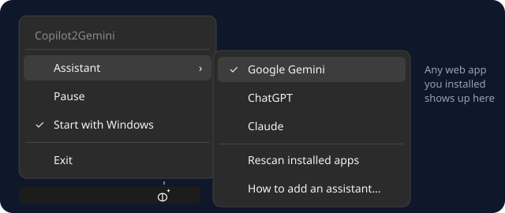
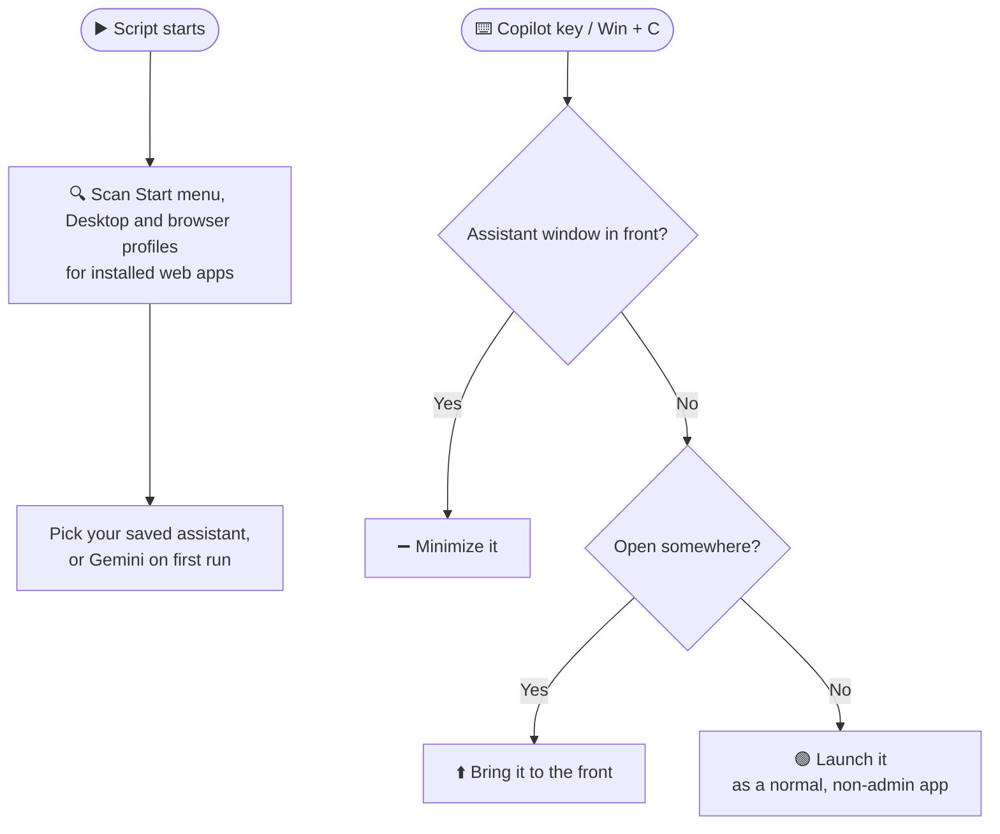

# 🚀 Copilot2Gemini

**Make your keyboard's Copilot key open Google Gemini instead** (or ChatGPT, Claude, or any other web app). One key to open, hide and bring back your assistant, just like a real built-in one.

  

---

## ⌨️ Controls

| You press | Your assistant is… | What happens |
|:--|:--|:--|
| `Copilot key` or `Win + C` | closed | 🟢 Opens it |
| `Copilot key` or `Win + C` | in front | ➖ Hides it (minimizes) |
| `Copilot key` or `Win + C` | behind other windows / minimized | ⬆️ Brings it to the front |
| `Ctrl` + `Copilot key` | anything | ➕ Opens an extra window |

✨ **Also:** the Start menu never pops up by accident, and the browser is started **without** admin rights (safer).

---

## 🚀 Get started

### Step 1 — Install Gemini as an app *(skip if you already did)*

Works with **Chrome, Brave or Edge**.

1. Open [gemini.google.com](https://gemini.google.com).
2. Click the **⋮ menu** (top right) → **Save and share** (or **Apps**) → **Install page as app…**
3. Click **Install**. Gemini now opens in its own window.

### Step 2 — Run Copilot2Gemini

**⚡ Easiest: download the .exe (no AutoHotkey needed)**

1. Go to **[Releases](https://github.com/mogdho/Copilot2Gemini/releases/latest)** and download **`Copilot2Gemini.exe`**.
2. **Double-click** it and click **Yes** on the admin pop-up.
3. A notification says **"Found Google Gemini"**. Press the **Copilot key**. 🎉

> 🛡️ **"Windows protected your PC"?** The .exe isn't code-signed (that costs money), so Windows SmartScreen may warn you. Click **More info** → **Run anyway**. Don't trust it? Use the script version below and read the code yourself.

**🛠️ Or run the script with AutoHotkey**

1. Install **[AutoHotkey v2](https://www.autohotkey.com/)** (free).
2. **Download** this repository: green **Code** button → **Download ZIP**, then unzip it.
3. **Double-click** `Copilot2Gemini.ahk` and click **Yes** on the admin pop-up.
4. A notification says **"Found Google Gemini"**. Press the **Copilot key**. 🎉

**There's nothing to configure.** The script finds the apps you installed in Step 1 by itself: browser, profile and app ID included.

> **No Gemini app installed?** The Copilot key still works: it opens gemini.google.com in your normal browser.
>
> **Why admin?** Without it, Windows ignores the key while an admin app (Task Manager, installers…) is in front. Your browser still starts as a normal app.

---

## 🗂️ Tray menu: pick your assistant

Right-click the tray icon:

  

| Option | What it does |
|:--|:--|
| **Assistant ›** | Lists every web app installed from Chrome, Brave or Edge. Click one to put it on the Copilot key. Your choice is remembered. |
| **Assistant › Rescan installed apps** | Use this after installing a new app (e.g. ChatGPT or Claude). |
| **Pause** | The Copilot key goes back to normal until you resume. The icon fades. *Tip: double-click the tray icon to pause / resume.* |
| **Start with Windows** | Starts the script automatically when you log in, **with no admin pop-up**. Click again to turn it off. |
| **Exit** | Closes the script. |

### ➕ Use ChatGPT, Claude or anything else

1. Open the site (e.g. [chatgpt.com](https://chatgpt.com) or [claude.ai](https://claude.ai)) and **install it as an app**, same as Step 1.
2. Right-click the tray icon → **Assistant** → **Rescan installed apps**.
3. Pick it from the **Assistant** list. Done!

---

## 🧠 How it works

- **Finding apps:** installed web apps have shortcuts that start the browser with `--app-id=…`. The script reads those shortcuts.
- **Finding the window:** every web-app window carries a hidden Windows ID made from its app ID, so the script finds the right window even when its title changes (ChatGPT, for example, shows the chat name).
- **Copilot key:** it secretly sends `Win + Shift + F23`, so the script listens for that (plus `Win + C`).
- Your choice is saved in `Copilot2Gemini.ini` next to the script.

---

## ❓ Troubleshooting

| Problem | Fix |
|:--|:--|
| It opens Gemini in a **browser tab** | No Gemini app was found. Do **Step 1**, then tray → **Assistant** → **Rescan installed apps**. |
| My new app isn't in the **Assistant** list | Tray → **Assistant** → **Rescan installed apps**. |
| Wrong Google account | If you installed the app in several browser profiles, each one is listed with its profile name. Pick the right one. |
| Copilot key does nothing | Check the tray icon is there and not faded (paused). Make sure you installed AutoHotkey **v2**. |
| Windows Copilot still opens | Run the script as admin: click **Yes** on the pop-up, or tick **Start with Windows**. |

---

## 🗑️ Uninstall

1. Right-click the tray icon → **untick Start with Windows** *(removes its startup task)*.
2. Right-click the tray icon → **Exit**.
3. Delete `Copilot2Gemini.exe` / `.ahk` and `Copilot2Gemini.ini` next to it.

> ⚠️ **Already deleted it?** The startup task is left behind. Press `Win + R` → `taskschd.msc` → right-click **Copilot2Gemini (AutoHotkey)** → **Delete**.

---

### 🔗 Download / Source
- 📂 **Repository:** [github.com/mogdho/Copilot2Gemini](https://github.com/mogdho/Copilot2Gemini)

### 👨‍💻 Author
**Mogdho Paul** · [github.com/mogdho](https://github.com/mogdho)
